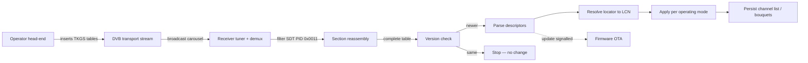

# TKGS Protocol Reference

An unofficial, vendor-neutral technical reference for **TKGS** — *TÜRKSAT Kanal
Güncelleme Sistemi* (TÜRKSAT Channel Update System), the over-the-air
channel-management protocol broadcast in the DVB stream on TÜRKSAT satellites.

TKGS lets a satellite operator keep every receiver's channel list correct —
renumbering, relocating, adding, hiding and grouping services — entirely through
**one-way broadcast**, with no return channel. A receiver only ever *listens*:
it filters a set of DVB-SI tables out of the transport stream, reconciles them
against what it has stored, and (optionally) applies a firmware update the
operator signals the same way.

> **Status.** This is a community reference describing the protocol as it appears
> on air. It is **not** an official TÜRKSAT publication and carries no normative
> authority. Field names and values reflect observed, interoperable behaviour;
> where a detail is conventional rather than guaranteed, the text says so.

## Contents

| # | Section | What it covers |
|---|---------|----------------|
| 1 | [Overview](docs/01-overview.md) | Model, goals, terminology, data-flow diagram |
| 2 | [Transport](docs/02-transport.md) | Where TKGS rides: PID, tables, the broadcast carousel |
| 3 | [Sections](docs/03-sections.md) | Section format, reassembly, CRC, completeness |
| 4 | [Descriptors](docs/04-descriptors.md) | Private descriptor tags and their byte layouts |
| 5 | [Locator → LCN](docs/05-locator-lcn.md) | How a service resolves to a channel number |
| 6 | [Operating modes](docs/06-operating-modes.md) | Off / Fixed / Customizable semantics |
| 7 | [Versioning & update](docs/07-version-update.md) | Version compare, apply rules, OTA signalling |
| 8 | [Glossary](docs/08-glossary.md) | Abbreviations and terms |

## Quick picture

## Using this reference

Each section is self-contained Markdown and renders directly on GitHub. Diagrams
use [Mermaid](https://mermaid.js.org/), which GitHub renders natively. To publish
as a site, enable **Settings → Pages → Deploy from branch → `main` / root**; no
build toolchain is required.

## Contributing

Corrections and additions are welcome, especially independent on-air captures that
confirm or refine a field layout. Please cite how a value was observed (table id,
descriptor tag, raw bytes) rather than a single implementation's source, so the
reference stays vendor-neutral. See [`CONTRIBUTING.md`](CONTRIBUTING.md).

## License

Documentation is licensed under
[CC BY 4.0](https://creativecommons.org/licenses/by/4.0/). See [`LICENSE`](LICENSE).
