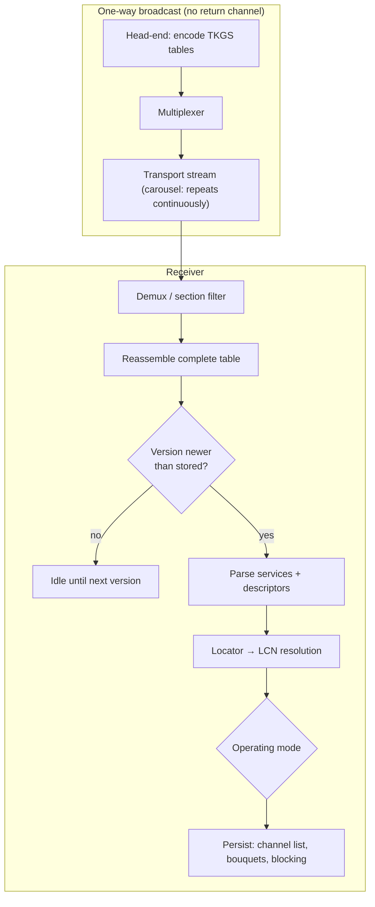

# 1. Overview

## 1.1 What TKGS is

TKGS (*TÜRKSAT Kanal Güncelleme Sistemi*, "Channel Update System") is a
broadcast-driven provisioning protocol. The operator publishes the authoritative
view of the service lineup — channel numbers, groupings, visibility and
locations — as additional data inside the normal DVB Service Information (SI) that
is already present in every transport stream. Receivers that implement TKGS read
this data and keep their stored channel list in sync without any user action and
without a return path.

It solves three recurring problems for a large DTH platform:

1. **Renumbering / relocation.** When a service changes transponder or logical
   channel number, the operator updates the broadcast mapping and every receiver
   follows automatically.
2. **Curation.** The operator can define ordered lists ("preferred lists" /
   bouquets) and categories, and mark services hidden or blocked.
3. **Maintenance.** The same channel can signal that a firmware update is
   available, which receivers may fetch and apply.

## 1.2 Design model

Key consequences of the broadcast-only model:

- **Idempotence.** Because the table repeats on a carousel, a receiver may see it
  many times. A **version** value that changes with every update lets it act once
  and ignore repeats
  (see [§7](07-version-update.md)).
- **Completeness before action.** A table may be split across several sections.
  A receiver must collect *all* of them before it can safely apply anything
  (see [§3](03-sections.md)).
- **Indirection.** Services are referenced by an abstract **locator**, not by a
  raw frequency/transport tuple, so the operator can move a service by changing
  only the mapping (see [§5](05-locator-lcn.md)).

## 1.3 Relationship to DVB-SI

TKGS does not define a new transport. It reuses DVB SI tables and the standard
MPEG-2 *private section* framing, and adds its payload through **private
descriptors** in the user-defined descriptor-tag range. A receiver therefore
parses TKGS with the same section/descriptor machinery it already uses for DVB,
recognising a small number of additional descriptor tags.

Standard DVB elements used as-is:

- **SDT** (Service Description Table) on **PID `0x0011`** as the primary carrier.
- `service_descriptor` (tag `0x48`) for service type and names.
- Private descriptor tag range **`0x80`–`0xFE`** for TKGS-specific data.

## 1.4 How to read this document

- Byte offsets are **zero-based** and measured from the start of the structure
  being described.
- Multi-byte integers are **big-endian** (network order), matching MPEG-2/DVB.
- Bit fields are described most-significant-bit first.
- "Reserved" bits should be ignored on receive and are conventionally set to `1`.

Continue to [§2 Transport](02-transport.md).
