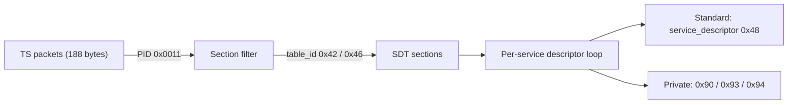
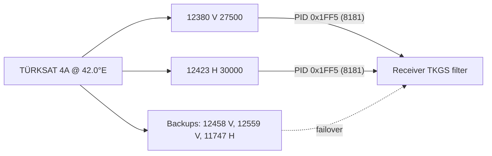

# 2. Transport

## 2.1 The carousel

TKGS data is inserted into the MPEG-2 transport stream at the head-end and
**repeated continuously** — a *data carousel*. There is no request/response; the
receiver acquires the data purely by filtering it out of whatever is currently on
air. Because the data repeats, acquisition is robust to packet loss: a section
missed on one cycle arrives on the next.

A receiver typically acquires TKGS from a **home / bootstrap transponder** that
the platform guarantees always carries the tables. Several home transponders are
provided for redundancy ([§2.4](#24-home-transponders-and-the-tkgs-pid)). From
there the broadcast may point the receiver at other transponders to complete the
picture.

## 2.2 Carrier table and PID

The primary carrier is the **Service Description Table (SDT)** on the
well-known DVB PID:

| Element | Value | Notes |
|---------|-------|-------|
| PID | `0x0011` | Standard DVB SDT/BAT PID |
| `table_id` `0x42` | SDT, actual transport stream | Services on the TS currently tuned |
| `table_id` `0x46` | SDT, other transport stream | Services on other TSs of the network |

A receiver filters sections on PID `0x0011` and accepts `table_id` `0x42` and
`0x46`. Both may be required for a complete view: *actual* describes the current
multiplex, *other* describes the rest of the network. An implementation commonly
tracks that **both** have been seen before treating the SDT view as complete.

> Bouquet and network grouping information may additionally appear in the BAT
> (Bouquet Association Table, also PID `0x0011`, `table_id` `0x4A`) and NIT
> (Network Information Table, PID `0x0010`). Where present, these carry the same
> style of private descriptors described in [§4](04-descriptors.md).

## 2.3 Why SDT

The SDT already enumerates every service with its `service_id` and a descriptor
loop per service. TKGS extends that descriptor loop with private descriptors
(names, categories, and the locator→LCN mapping), so the operator can attach
channel-management metadata to the exact services it already announces, with no
new table type and full backward compatibility: a non-TKGS receiver simply
ignores the unknown descriptors.

## 2.4 Home transponders and the TKGS PID

TKGS data is acquired from a small set of **home transponders** on TÜRKSAT at
**42.0°E** (TÜRKSAT 4A). Receiver set-up guides and installer documentation
consistently give the values below. They are *observed in practice*, not taken
from an official TÜRKSAT specification; the operator can change them at any time.

| Role | Frequency | Pol. | Symbol rate | FEC | TKGS PID |
|------|-----------|------|-------------|-----|----------|
| Primary | 12380 MHz | V | 27500 kS/s | 3/4 | `8181` (`0x1FF5`) |
| Primary (alt.) | 12423 MHz | H | 30000 kS/s | 3/4 | `8181` (`0x1FF5`) |
| Backup | 12458 MHz | V | — | — | `8181` (`0x1FF5`) |
| Backup | 12559 MHz | V | — | — | `8181` (`0x1FF5`) |
| Backup | 11747 MHz | H | 27500 kS/s | — | `8181` (`0x1FF5`) |

Notes:

- **Use one PID on every transponder.** Every source gives the same TKGS PID,
  `8181` decimal (`0x1FF5`), on all home transponders. Receivers that let the user
  edit the TKGS source usually ask for this PID in **decimal**.
- **Use several sources for failover.** Installer guides recommend configuring
  the primary entries and the backups so a receiver can fall back to another
  transponder when one is off air or cannot be received.
- **Treat the frequencies as data, not as constants.** The `12423` H entry also
  appears as `12422` H in some sources. A receiver should store the home
  transponder list as editable configuration rather than hard-coding it.
- **Some values are still open.** Blank cells (`—`) are not given consistently by
  the sources. The `table_id` used on PID `0x1FF5`, and how that table relates to
  the SDT-descriptor carriage described in §2.2–§2.3, have **not yet been
  confirmed from an on-air capture**. Contributions with raw section dumps from
  PID `0x1FF5` are especially welcome (see [`CONTRIBUTING.md`](../CONTRIBUTING.md)).

## 2.5 Acquisition lifecycle

1. **Tune** a home transponder ([§2.4](#24-home-transponders-and-the-tkgs-pid));
   on failure, try the next one in the list.
2. **Filter** the TKGS PID `0x1FF5` (8181), and PID `0x0011` `table_id`
   `0x42`/`0x46` for the SDT view. How the two relate is still open (§9).
3. **Reassemble** each table from its sections ([§3](03-sections.md)).
4. **Check version** against stored state ([§7](07-version-update.md)).
5. **Parse and apply** if newer ([§4](04-descriptors.md)–[§6](06-operating-modes.md)).
6. **Idle** on the carousel; re-check when the broadcast version changes.

## 2.6 Acquisition timing (receiver guidance)

TKGS-specific repetition rates are **not published**
([§9](09-open-questions.md)). The DVB guidance in ETSI TR 101 211 gives the
expected order of magnitude for the SI tables involved:

| Table | Max. interval between repetitions (TR 101 211) |
|-------|-----------------------------------------------|
| SDT actual (`0x42`) | 2 s |
| SDT other (`0x46`), BAT, NIT | 10 s |

Suggested, non-normative receiver behaviour:

- **Per-transponder timeout.** Wait at least two full carousel cycles before
  deciding a home transponder carries no TKGS data. For a 10 s cycle, that is
  ~20–30 s. Then move on to the next entry in §2.4.
- **When to check.** At power-on or wake from standby, during standby
  maintenance windows, and when the user selects "update now". Watching
  continuously while the user watches a channel on the home transponder costs
  almost nothing and catches changes as they happen.
- **Do not retune the user's live viewing** just to check TKGS. Defer the check
  to standby, or to a moment when the user is already on a home transponder.

Continue to [§3 Sections](03-sections.md).
