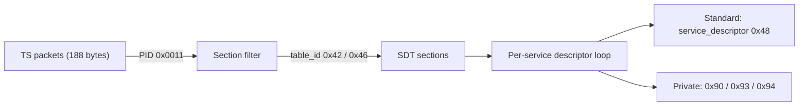

# 2. Transport

## 2.1 The carousel

TKGS data is inserted into the MPEG-2 transport stream at the head-end and
**repeated continuously** — a *data carousel*. There is no request/response; the
receiver acquires the data purely by filtering it out of whatever is currently on
air. Because the data repeats, acquisition is robust to packet loss: a section
missed on one cycle arrives on the next.

A receiver typically acquires TKGS from a **home / bootstrap transponder** that
the platform guarantees always carries the tables. From there the broadcast may
point the receiver at other transponders to complete the picture.

## 2.2 Carrier table and PID

The primary carrier is the **Service Description Table (SDT)** on the
well-known DVB PID:

| Element | Value | Notes |
|---------|-------|-------|
| PID | `0x0011` | Standard DVB SDT/BAT PID |
| `table_id` `0x42` | SDT, actual transport stream | Services on the TS currently tuned |
| `table_id` `0x46` | SDT, other transport stream | Services on other TSs of the network |

A receiver filters sections on PID `0x0011` and accepts `table_id` `0x42` and
`0x46`. Both may be required for a complete view: *actual* describes the current
multiplex, *other* describes the rest of the network. An implementation commonly
tracks that **both** have been seen before treating the SDT view as complete.

> Bouquet and network grouping information may additionally appear in the BAT
> (Bouquet Association Table, also PID `0x0011`, `table_id` `0x4A`) and NIT
> (Network Information Table, PID `0x0010`). Where present, these carry the same
> style of private descriptors described in [§4](04-descriptors.md).

## 2.3 Why SDT

The SDT already enumerates every service with its `service_id` and a descriptor
loop per service. TKGS extends that descriptor loop with private descriptors
(names, categories, and the locator→LCN mapping), so the operator can attach
channel-management metadata to the exact services it already announces, with no
new table type and full backward compatibility: a non-TKGS receiver simply
ignores the unknown descriptors.

## 2.4 Acquisition lifecycle

1. **Tune** the bootstrap transponder.
2. **Filter** PID `0x0011`, `table_id` `0x42`/`0x46`.
3. **Reassemble** each table from its sections ([§3](03-sections.md)).
4. **Check version** against stored state ([§7](07-version-update.md)).
5. **Parse and apply** if newer ([§4](04-descriptors.md)–[§6](06-operating-modes.md)).
6. **Idle** on the carousel; re-check when the broadcast version changes.

Continue to [§3 Sections](03-sections.md).
