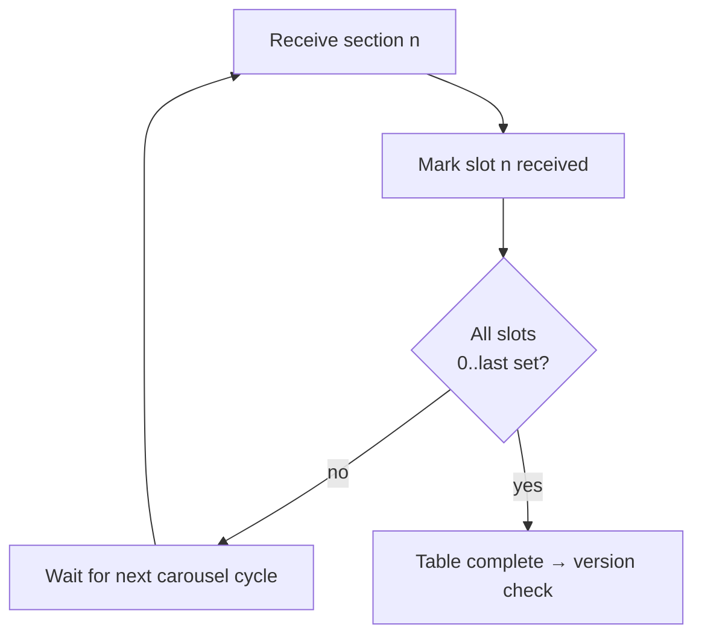

# 3. Sections and reassembly

TKGS payloads are carried in MPEG-2 **private sections** (the framing DVB uses for
SI). A logical table may be larger than one section, so it is split into a
numbered set of sections that the receiver must collect and reassemble before
acting.

## 3.1 Section header

Every section begins with the standard MPEG-2 private-section header. The fields
that matter for reassembly:

| Field | Bits | Meaning |
|-------|------|---------|
| `table_id` | 8 | `0x42` / `0x46` for SDT (see [§2](02-transport.md)) |
| `section_syntax_indicator` | 1 | `1` for long-form sections used here |
| `section_length` | 12 | Bytes following this field, **including** the 4-byte CRC |
| `table_id_extension` | 16 | For SDT, the `transport_stream_id` |
| `version_number` | 5 | Increments when the table's content changes |
| `current_next_indicator` | 1 | `1` = currently applicable |
| `section_number` | 8 | This section's index, `0`-based |
| `last_section_number` | 8 | Index of the final section of the table |
| `CRC_32` | 32 | Trailing 4 bytes; covers the whole section |

The 12-bit `section_length` is encoded as `(byte[0] & 0x0F) << 8 | byte[1]`
relative to its position — the same nibble-plus-byte pattern used throughout the
nested length fields of the TKGS descriptors ([§4](04-descriptors.md)).

## 3.2 Completeness rule

A receiver **must not** apply a table until it holds every section from
`section_number = 0` through `last_section_number`, all with the same
`version_number`. Implementations track this with a small bitmap of received
section numbers and only proceed when every slot `0..last_section_number` is set.

Consequences:

- Under weak signal the bitmap never fills, so a TKGS-capable receiver simply does
  nothing rather than acting on a partial table. This is the intended fail-safe.
- If `version_number` changes mid-collection, the receiver discards the partial
  set and restarts, because sections of different versions must not be mixed.

## 3.3 Payload boundary and CRC

The usable payload ends **4 bytes before** the end of the section; those last
4 bytes are the `CRC_32`. A parser computes the payload end as
`section_start + section_length - 1`, then stops descriptor parsing 4 bytes
earlier to exclude the CRC. A failed CRC means the section is dropped and
re-acquired on the next cycle.

Continue to [§4 Descriptors](04-descriptors.md).
