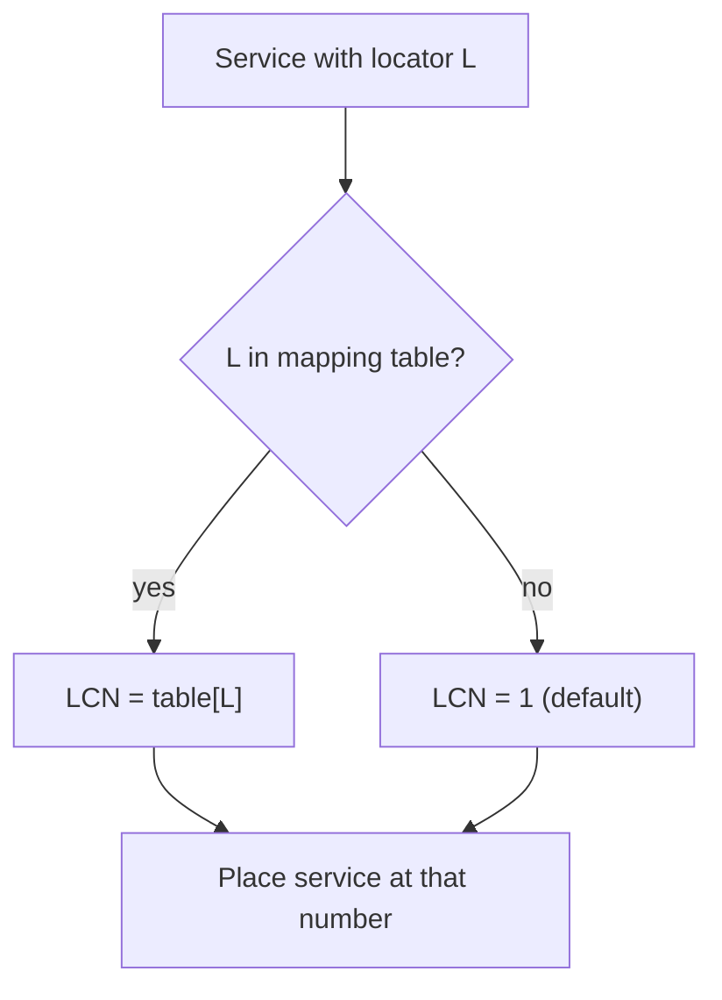

# 5. Locator → LCN resolution

The **locator** is the heart of TKGS. Instead of telling receivers "channel N is
service S on transponder T", the broadcast says "channel N is whatever the
*locator* L currently points to." The operator can then relocate a service by
publishing a new mapping for L; every receiver re-resolves and follows, with no
rescan.

## 5.1 The mapping table

As a receiver parses locator descriptors ([§4.4](04-descriptors.md#44-locator-descriptor-0x94))
it accumulates a table of `{locator, lcn}` pairs — the current channel numbering.
Logically:

| Field | Size | Meaning |
|-------|------|---------|
| `locator` | 16-bit | operator-assigned service handle (the lookup key) |
| `lcn` | 13-bit | logical channel number to present to the user |

A minimal in-memory form is a flat array of 4-byte entries plus a count. Lookup is
a linear scan keyed on `locator`.

## 5.2 Resolution algorithm

```text
resolve(locator, table) -> lcn:
    for entry in table:
        if entry.locator == locator:
            return entry.lcn        # found
    return DEFAULT_LCN              # not found
```

Rules observed in practice:

- **Exact match on `locator`.** No ranges, no wildcards.
- **Miss → default.** An unknown locator has been observed to resolve to a
  **default channel number of `1`** rather than being hidden. *Evidence status:
  seen in one implementation and not confirmed across receivers.* See §5.5 for a
  safer handling. A receiver should treat "not found" as a soft
  fallback, not an error that drops the service.
- **Last writer wins.** If the broadcast carries two mappings for the same
  locator within one update, the later entry is the effective one.



## 5.3 Why the indirection matters

Because the receiver keys on the locator and not on physical coordinates:

- **Moving a transponder** is invisible to the channel list — only the mapping the
  locator points to changes.
- **Renumbering** is a pure data edit at the head-end.
- **Receiver state stays small**: it remembers locators and numbers, not a full
  physical description of every service.

## 5.4 Relationship to stored channel data

The resolved `{locator → lcn}` view is reconciled against the receiver's own
service database (the services it has actually found by scanning). The locator ties
a *broadcast intent* ("this logical channel") to a *tuned service* ("this
service_id on this transport"), and the operating mode ([§6](06-operating-modes.md))
decides how strictly that intent overrides any local user edits.

## 5.5 Edge cases (receiver guidance)

The broadcast semantics for these cases are **not confirmed**
([§9](09-open-questions.md)). The guidance below is non-normative. It describes
robust receiver behaviour that does not depend on the answer.

| Case | Guidance |
|------|----------|
| **LCN range** | The field is 13 bits, so values are `0`–`8191`. Treat this as the whole valid range unless captures show a narrower one. |
| **LCN `0`** | Do not show a service at channel 0. Treat it like a miss: the service is "unnumbered". |
| **Locator miss** | Do not stack unmapped services on channel 1, which would hide the real channel 1 or make it ambiguous. Place them after the highest assigned LCN, in scan order, and mark them as not operator-numbered. |
| **Duplicate locator** | Last writer wins (§5.2). |
| **Duplicate LCN** (two locators → same number) | Keep the first one at the number and move the next to the first free LCN after the highest assigned one. Never drop a service silently. |
| **Mapping with no matching scanned service** | Keep the mapping. The service may appear after a scan or a transponder change. Do not create a placeholder channel. |
| **Scanned service with no mapping** | Same as *locator miss*. In **Fixed** mode the receiver may instead hide it (§6). |

Continue to [§6 Operating modes](06-operating-modes.md).
