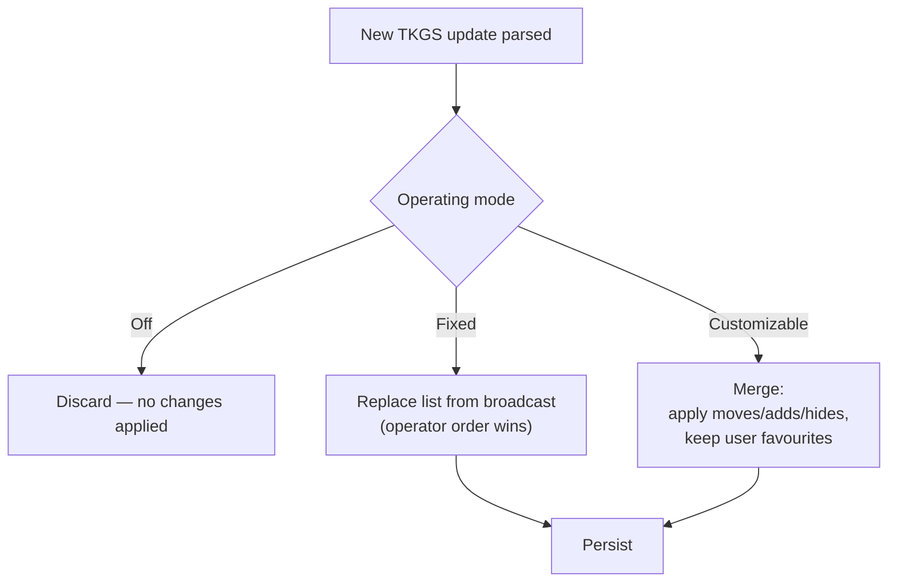

# 6. Operating modes

TKGS defines an **operating mode** that controls how aggressively the broadcast
overrides the receiver's local channel list. The mode is a receiver setting,
influenced by the broadcast and by the user, and it is the main knob balancing
"operator knows best" against "don't touch my edits."

## 6.1 The three modes

| Mode | Turkish | Behaviour |
|------|---------|-----------|
| **Off** | *Kapalı* | TKGS is ignored. The stored channel list is never modified by the broadcast. |
| **Fixed** | *Sabit* | The operator list is authoritative. The channel list is rebuilt from the broadcast; user reordering/edits are not kept. |
| **Customizable** | *Esnek* | Broadcast changes are merged, but user customisations (favourites, manual order where allowed) are preserved. |

## 6.2 How a mode changes behaviour

- **Off** is a true opt-out: even a newer broadcast version is not applied.
- **Fixed** means the receiver surfaces the operator's exact ordering and grouping.
  Manual channel editing is typically disabled; a receiver UI commonly tells the
  user to *switch TKGS off* before editing.
- **Customizable** is the middle ground: structural changes from the operator
  (a channel moved number, a new channel, a hidden channel) are applied, while the
  user's own list customisations survive. A receiver UI commonly tells the user to
  switch to *off or customizable* before an edit that Fixed would forbid.

## 6.3 Interaction with versioning

Mode is evaluated **after** the version check ([§7](07-version-update.md)): the
receiver first decides whether a broadcast is newer than what it applied, and only
then consults the mode to decide *how* to apply it. In **Off**, the version is
effectively ignored because nothing is applied regardless.

## 6.4 Related curation data

Independent of mode, TKGS can carry:

- **Preferred list / bouquet** — a named, ordered list of services the operator
  wants presented together (e.g. an HD bouquet). The active list is selected by
  name.
- **Blocking / hidden** — services the operator marks as not to be shown.
- **Categories** — named groupings (via the `0x90` descriptor) for organising the
  guide.

How strictly these override local state again depends on the operating mode.

Continue to [§7 Versioning & update](07-version-update.md).
