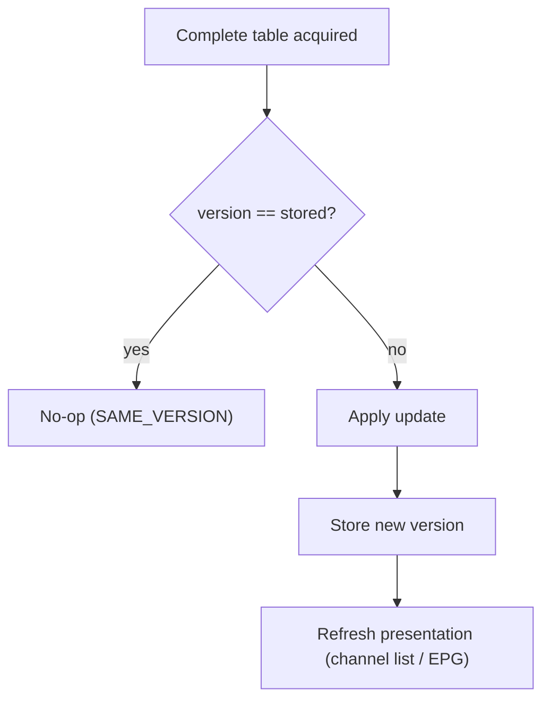
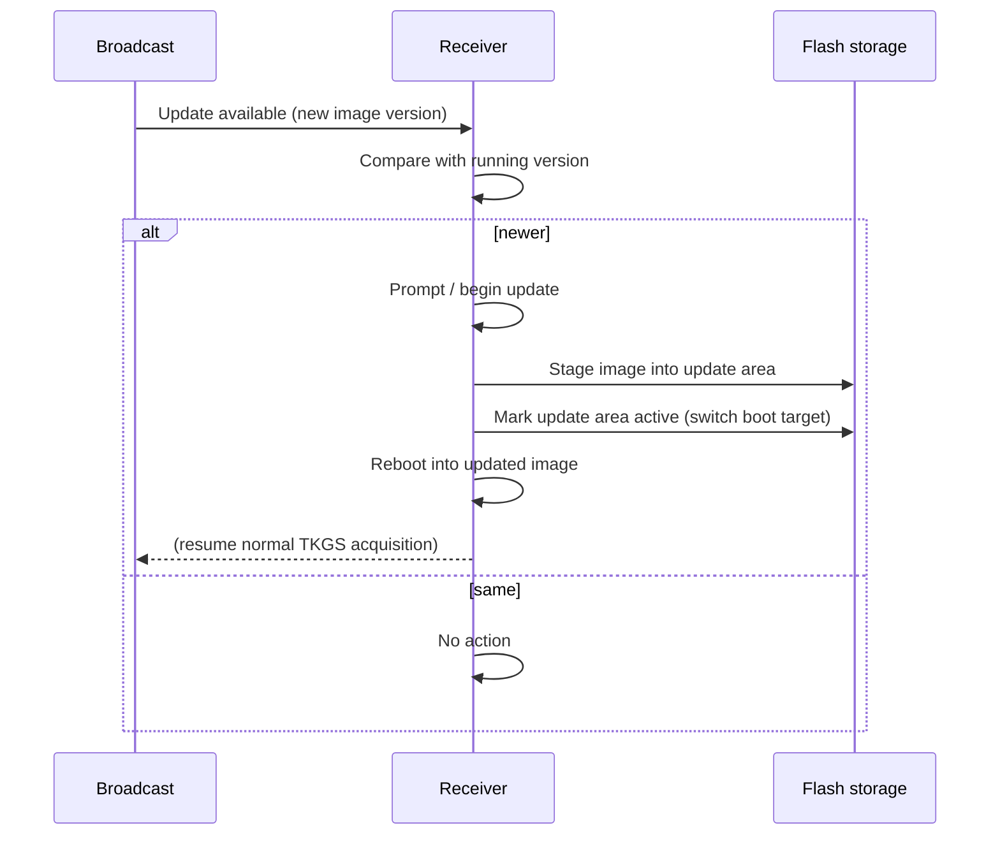

# 7. Versioning and software update

## 7.1 The TKGS version

TKGS carries a **version** value that the operator increments whenever the
channel-management data changes in a way receivers should apply. The receiver
stores the version of the last update it applied and compares on every acquisition.

| Outcome | Condition | Action |
|---------|-----------|--------|
| Same version | broadcast version == stored | Do nothing; stay idle on the carousel |
| New version | broadcast version != stored | Parse and apply per operating mode |

**Compare for inequality, not "greater than".** The width of the version field
and its wrap-around behaviour have not been confirmed
([§9](09-open-questions.md)). An inequality test is correct whatever the answer.
It handles wrap-around (e.g. `31 → 0` for a 5-bit field), and it handles an
operator rolling back to an earlier list. A "greater than" test would silently
ignore both. Elsewhere in this document "newer" means "different from what is
stored".

This is what makes the repeating carousel safe to watch forever: the receiver acts
**once** per version and treats all later repeats of that version as no-ops.

- The stored version is persisted so the comparison survives a reboot.
- After a successful apply, the receiver records the new version and refreshes the
  presented channel list / guide so the user sees the change.
- Distinguish this **TKGS content version** from the DVB section
  `version_number` ([§3](03-sections.md)): the section field detects that a table's
  *bits* changed and triggers re-collection; the TKGS version decides whether the
  *channel data* should be re-applied.

## 7.2 Software (firmware) update signalling

The same broadcast channel can indicate that a **firmware update** is available.
When signalled, a TKGS receiver may notify the user, download the image, and
switch to it. The protocol-visible parts are the *signal* and the *handoff*; the
image format and flashing are implementation-specific.

**Where the update signal comes from.** The channel-update data is acquired from
the home transponders on PID `0x1FF5` (8181)
([§2.4](02-transport.md#24-home-transponders-and-the-tkgs-pid)). Public sources
do not document which table or PID carries the *firmware* signal, or where the
image is carried. Do not assume it shares PID `0x1FF5` until a capture confirms it.

**Comparison with DVB SSU.** The generic DVB mechanism for over-the-air software
update is *System Software Update* (ETSI TS 102 006). It signals updates with a
`data_broadcast_id_descriptor` (`0x66`) or a `linkage_descriptor` (`0x09`,
linkage type `0x09`) and delivers the image in a DSM-CC data carousel. It
targets receivers by IEEE OUI, hardware model/version and software version.
Whether TKGS firmware updates use SSU, a variant of it, or a private scheme is
**unconfirmed**. SSU is listed here because it is the obvious first thing to look
for in a capture: linkage type `0x09` in the NIT/BAT, or stream type `0x0B` in
a PMT. Any TKGS update scheme must solve the same targeting problem (which
receivers an image is for), so this section should eventually document the
equivalent fields.

Typical sequence:

Design points that are common across implementations:

- **Versioned, not forced-in-place.** The receiver compares the offered image
  version with what it runs and only updates when newer — mirroring the channel
  version rule.
- **Staged + switch.** A robust receiver writes the new image to a separate area
  and then flips the active/boot pointer, rather than overwriting the running image
  in place. This makes the update resumable and failure-tolerant.
- **User-visible state.** Updates surface progress ("updating, please wait") and a
  success/failure result; a cancel path is typical.

## 7.3 Note on alternative update channels

Some receivers also implement an **IP-based** update check (an HTTP(S) query keyed
on hardware/software version) in addition to the satellite path. That is outside
the broadcast TKGS protocol proper and is mentioned only to avoid conflating the
two: the TKGS path described here requires no network connectivity.

Continue to [§8 Glossary](08-glossary.md).
