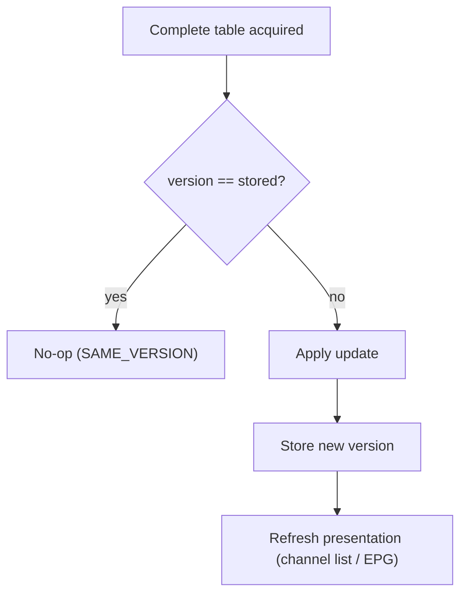
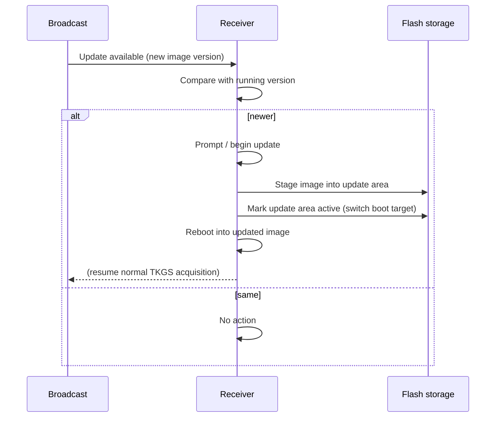

# 7. Versioning and software update

## 7.1 The TKGS version

TKGS carries a **version** value that the operator increments whenever the
channel-management data changes in a way receivers should apply. The receiver
stores the version of the last update it applied and compares on every acquisition.

| Outcome | Condition | Action |
|---------|-----------|--------|
| Same version | broadcast version == stored | Do nothing; stay idle on the carousel |
| New version | broadcast version != stored (newer) | Parse and apply per operating mode |

This is what makes the repeating carousel safe to watch forever: the receiver acts
**once** per version and treats all later repeats of that version as no-ops.

- The stored version is persisted so the comparison survives a reboot.
- After a successful apply, the receiver records the new version and refreshes the
  presented channel list / guide so the user sees the change.
- Distinguish this **TKGS content version** from the DVB section
  `version_number` ([§3](03-sections.md)): the section field detects that a table's
  *bits* changed and triggers re-collection; the TKGS version decides whether the
  *channel data* should be re-applied.

## 7.2 Software (firmware) update signalling

The same broadcast channel can indicate that a **firmware update** is available.
When signalled, a TKGS receiver may notify the user, download the image, and
switch to it. The protocol-visible parts are the *signal* and the *handoff*; the
image format and flashing are implementation-specific.

Typical sequence:

Design points that are common across implementations:

- **Versioned, not forced-in-place.** The receiver compares the offered image
  version with what it runs and only updates when newer — mirroring the channel
  version rule.
- **Staged + switch.** A robust receiver writes the new image to a separate area
  and then flips the active/boot pointer, rather than overwriting the running image
  in place. This makes the update resumable and failure-tolerant.
- **User-visible state.** Updates surface progress ("updating, please wait") and a
  success/failure result; a cancel path is typical.

## 7.3 Note on alternative update channels

Some receivers also implement an **IP-based** update check (an HTTP(S) query keyed
on hardware/software version) in addition to the satellite path. That is outside
the broadcast TKGS protocol proper and is mentioned only to avoid conflating the
two: the TKGS path described here requires no network connectivity.

Continue to [§8 Glossary](08-glossary.md).
